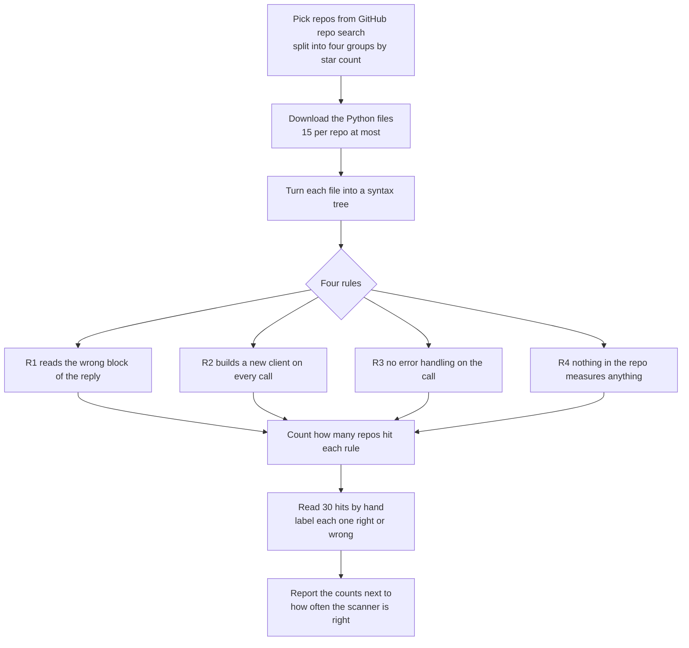

# llm-code-audit

Four mistakes in code that calls an LLM API, found by reading the syntax tree.

No model, no API key, no cost. The same input always gives the same answer.

## What it does



Step F is not optional. A count from a scanner nobody has checked is a guess
with a decimal point.

## The four rules

Each one is a mistake I made and fixed. They are not style opinions.

**R1. Reading the wrong block of the reply.** `response.content[0].text` assumes
the first thing the model sends back is text. When extended thinking is on, the
first thing is a thinking block, and this line crashes.

**R2. Building a new client on every call.** If the client is created inside a
function that runs over and over, every single request opens a new connection.

**R3. No error handling on the network call.** The call to the API fails and the
program either stops dead or quietly carries on with nothing.

**R4. Nothing measures the code.** No tests, no checks in CI. A program that
calls a service which gives a different answer every time, and nothing watching
it.

## Why a syntax tree and not a text search

A text search looks at characters. These questions are about structure.

"Is the client built inside a function that runs repeatedly" is a question about
what sits inside what. A text search can find the word `Anthropic`. It cannot
tell you whether that line is inside a function, because it has no idea what a
function is.

And the spelling changes while the structure does not:

```
response.content[0].text      text search finds it
resp.content[ 0 ].text        text search misses it
msg.content[0] .text          text search misses it
```

All three are the same tree. Python has a built in `ast` module that hands you
that tree, so the rules ask structural questions and spacing stops mattering.

## What it will not do

**No names.** The published output is counts only. No repo names, no owners, no
links.

**No issues, no pull requests, no messages.** Nobody is contacted.

**Examples are written by hand.** A real code snippet is searchable, so quoting
one identifies the repo as surely as naming it. Every example here was typed by
me.

**No credential hunting.** A rule for hardcoded API keys was considered and
rejected. It is the easiest thing to detect and the worst thing to publish.
Counting live credentials in public repos is a security disclosure problem, not
a code quality finding, and GitHub already scans for it.

## How the repos are picked, and the version that was wrong

A count from "whatever the search ranked first" looks like a statistic about
all repos and is really a statistic about the ranking. So the sample is split
into four groups by star count, and each group is its own search.

```
0            learning projects, tutorials, abandoned
1 to 10      small real projects
11 to 100    has users
101 and up   has a community
```

That also makes the answer sharper than one number could be. **"The rate barely
moves as stars go up" is a finding. "Seven in ten repos" on its own is not,
because it hides which seven.**

### The first version silently did nothing

It searched **code** for `import anthropic` and added `stars:` to the query. It
ran. It returned results. The results were nonsense:

```
import anthropic language:python          1,730,560 files
  the same query with stars:0                     2
  the same query with stars:1..10                 0
  the same query with stars:>100                 65
```

Two plus zero plus 65, out of 1.73 million. **`stars:` is not a code search
qualifier.** GitHub accepted it and ignored it. Nothing errored and nothing
warned. Two of the four groups came back empty and the only reason I looked was
that empty felt wrong.

Searching **repositories** instead, where `stars:` is real:

```
anthropic claude language:python stars:0      5,938
  stars:1..10                                 3,450
  stars:11..100                                 562
  stars:>100                                    207
```

Monotonic, sums to about ten thousand, and describable.

### What the sample actually is

Not "files that import the SDK". It is **repos whose name, description or
README mentions anthropic and claude**. That skews toward projects that describe
themselves, which are probably a bit more deliberate than average.

It is a different population from what the first version measured, and saying
so is the point. A headline that implied the broader one would be wrong in
exactly the way this whole project is about.

## A fifth rule, written and dropped

Passing `temperature` to a model that ignores it. The value is silently
discarded, so you believe you pinned the randomness and you did not.

Dropped because it needs an up to date list of which models ignore which
sampling settings, and that list goes stale. Four rules that depend on nothing
external beat five where one rots quietly.

## The first run found a bug, and a flaw in the scanner

The first thing it scanned was my own code, because that is the only code I can
check by eye.

It reported five R2 hits. **Four were wrong.** They were clients built inside
`main()`, which runs once, so there is nothing repeated about it. The rule asked
"is this inside a function" when the real question is "is this inside something
that runs repeatedly."

It also reported no tests on a repo that runs a checker in CI on every pull
request. Nothing was named like a test and something was very much measuring it.

Both rules were narrowed. What survived:

```
R3  judge.py:84        .messages.create() outside a try
R3  loop.py:102        .messages.create() outside a try
R3  loop.py:108        .messages.create() outside a try
R3  no_context.py:41   .messages.create() outside a try
R3  no_context.py:56   .messages.create() outside a try
R2  query.py:172       Anthropic() inside answer()
```

That last line is a real bug in a repo I had just called finished. `answer()` is
called once per question inside the evaluation loop, so it built a fresh client
every time. It is the same mistake I wrote down and fixed in a different project
in April.

**This is the reason step F exists.** The first version of this scanner was right
one time in five, and the only thing that caught it was pointing it at code I
knew well enough to argue with.

## Status

**Built.** The four rules. Scanning a local directory. Thirteen tests that pin
every false positive the rules have produced. The GitHub sampler, split by star
count, verified end to end on a sample of fifteen repos.

**Not built.** The hand labelled precision check, which is step F and the thing
that makes any published number defensible. The full sample. The writeup.

No number from this is publishable until step F is done.

## Run it

```
python3 test_rules.py                    the rules, including past false positives
python3 audit.py <path> [path ...]       scan a local directory
python3 sample.py --per-bucket 25        draw a sample and scan it
python3 sample.py --report               counts from the last sample
```

No dependencies for the scanner, it is the standard library `ast` module and
nothing else. `sample.py` needs the `gh` CLI, authenticated. Python 3.9 or
newer.

Repo names live in `findings_raw.json`, which is gitignored. `results.json`
holds counts only and is safe to commit.
